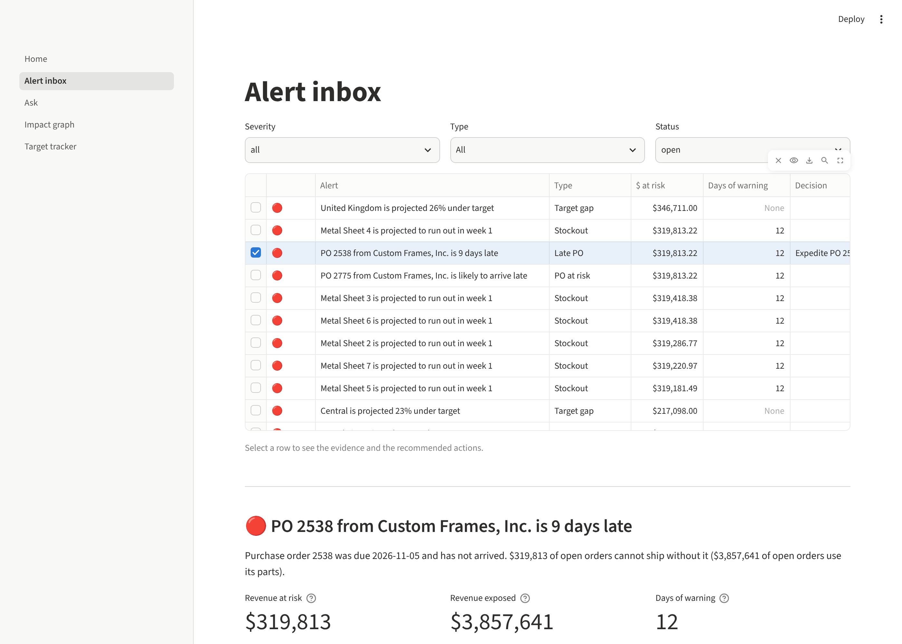

# PlanGraph: Connected Planning Copilot

A manufacturer runs sales orders, purchasing, production, inventory and financial targets in five separate systems, so a late supplier shipment only shows up as a revenue miss weeks later. PlanGraph joins the five systems into one knowledge graph and uses it to:

1. **raise alerts before a target is missed**, each priced in dollars at risk,
2. **explain the root cause** with the queries and the evidence path behind every answer,
3. **recommend an action** that a planner approves with one click, leaving an audit trail.

It is an end-to-end project: ERP-style data → Postgres → Neo4j knowledge graph → ML models → alert engine → LangGraph agent → FastAPI → Streamlit.



## Results

Measured on the simulated company (AdventureWorks sample data with four injected disruptions). See [docs/EVALUATION.md](docs/EVALUATION.md) for method and caveats.

| What | Result |
|---|---|
| Injected disruptions caught by the alert engine | 4 of 4 |
| Revenue at risk found for the slipping vendor | $319,813, 12 days before the first affected order is due |
| Demand forecast error (WAPE, 6-month backtest) | 18.3% vs 25.8% for "same as last month" |
| Late-PO classifier (AUC, time-based test split) | 0.64 vs 0.63 for the vendor's past late rate alone |
| Golden questions, documents only, no LLM | 35% (14 of 40) |
| Golden questions, one routed graph query, no LLM | 55% (22 of 40) |
| Golden questions, full LangGraph agent with Gemini | not yet run (needs an API key) |

The receipt dates behind the late-PO model are synthetic, so its AUC says little about real vendors. [docs/DATA.md](docs/DATA.md) lists exactly what is real and what is simulated.

## Quick start

You need Docker. Python 3.11+ is needed only for the local route.

**Everything in Docker**

```bash
cp .env.example .env        # optional: add GEMINI_API_KEY for the LLM agent
docker compose up --build   # first run takes a few minutes
```

Then open http://localhost:8501 (app) and http://localhost:8000/docs (API).

**Local development**

```bash
make setup && source .venv/bin/activate
make db          # Postgres + Neo4j in Docker
make pipeline    # about 75 seconds: load data, build graph, train models, raise alerts
make api         # terminal 1
make ui          # terminal 2
make test        # unit tests, no databases needed
```

Without a Gemini key the app runs in **offline mode**: alerts, graph view, targets and approvals all work, and the Ask page routes each question to one fixed graph query by keyword.

## Architecture

```
1 Sources      sales | purchasing | production | inventory | finance   (Postgres schemas) + markdown docs
                 │  prepare: pick planning date, shift dates to today, inject 4 disruptions
2 Staging      stg.*  clean joined tables + 17 data quality checks      (SQL)
                 │  batched UNWIND + MERGE
3 Graph        Neo4j: 14 node types, 17 relationship types, vector index on documents
                 │  read history / write predictions back
4 Intelligence demand forecast (LightGBM) · late-PO risk (logistic regression)
               inventory projection · alert engine (rules + graph traversal → $ at risk)
                 │  tools
5 AI layer     LangGraph agent · 8 templated Cypher tools · guarded Text2Cypher fallback
               vector search · action drafter
                 │  REST
6 API          FastAPI: /alerts /ask /graph/{uid} /targets /actions/approve /decisions /metrics
7 Frontend     Streamlit: Alert inbox · Ask · Impact graph · Target tracker
```

## Documentation

Read in this order. Each document explains the concepts with examples from this project.

| Document | What it covers |
|---|---|
| [docs/CONCEPTS.md](docs/CONCEPTS.md) | Supply chain and AI terms used in the project, each with a worked example |
| [docs/DATA.md](docs/DATA.md) | Every dataset and table: what it represents, how it is used, real vs synthetic |
| [docs/GRAPH_MODEL.md](docs/GRAPH_MODEL.md) | Nodes, relationships and each Cypher template explained line by line |
| [docs/MODELS.md](docs/MODELS.md) | The three models: purpose, features, backtests, metrics |
| [docs/ALERTS_AND_AGENT.md](docs/ALERTS_AND_AGENT.md) | Alert rules, the dollars-at-risk traversal, the agent, tools and guardrails |
| [docs/ARCHITECTURE.md](docs/ARCHITECTURE.md) | Layers, data flow, design decisions and what would change for production |
| [docs/EVALUATION.md](docs/EVALUATION.md) | How results were measured, the numbers, and their limits |
| [docs/RUNBOOK.md](docs/RUNBOOK.md) | Setup, commands, configuration, troubleshooting |
| [docs/BUILD_LOG.md](docs/BUILD_LOG.md) | Step-by-step record of what was built, verified and decided |

## Repository layout

```
src/plangraph/
  etl/        download, prepare, scenarios, staging.sql, quality checks
  graph/      schema, loader, Cypher templates, document loader
  models/     forecast, late_po, inventory, writeback
  alerts/     rules, impact traversal, engine
  agent/      LLM wrapper, tools, Text2Cypher, guardrails, LangGraph loop, offline mode, actions
  api/        FastAPI app
  eval/       scenario recall, golden questions, comparison runner
  pipeline.py the nightly job
ui/           Streamlit app
data/docs/    20 company documents (policies, procedures, emails)
tests/        unit and integration tests
docs/         documentation
```

## Data and licence notes

The data is Microsoft's public [AdventureWorks sample database](https://github.com/microsoft/sql-server-samples/tree/master/samples/databases/adventure-works) (MIT licence), downloaded at run time and not stored in this repository. The company documents in `data/docs/` were written for this project.
